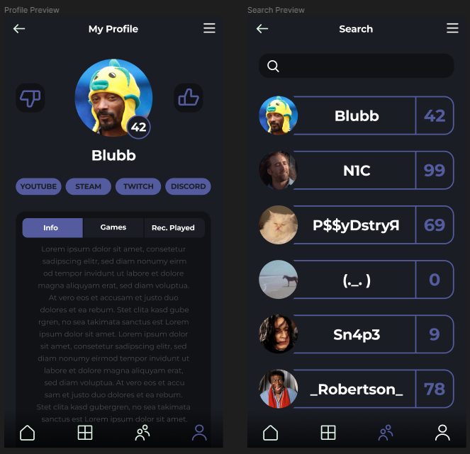

    <h1><b>+rep Dokumentation</b></h1>

## 🚩 1. Meilenstein
#### Projektidee:
Unser Produkt **+rep** beschreibt eine App, die es Spielern ermöglicht andere Spieler und Gruppen zu finden, die ihren Interessen entsprechen (z.B. durch Genres). Die App integriert Steam, um Spielinformationen zu sammeln und eine nahtlose Verbindung zu ermöglichen. Durch ein Bewertungssystem können Spieler ihre Erfahrungen mit anderen Benutzern teilen und Empfehlungen aussprechen, um eine aktive und freundliche Community aufzubauen. Mit der Funktion "Vorgeschlagene Spieler" werden Spieler auf andere Benutzer aufmerksam gemacht, die ähnliche Vorlieben haben, um neue Freunde und Teams zu finden und eine gute Gaming-Session zu erleben.

#### Skizze:
  
#### Zielgruppe:
Haupstsächlich Gamer die mind. 13 Jahre alt sind.
