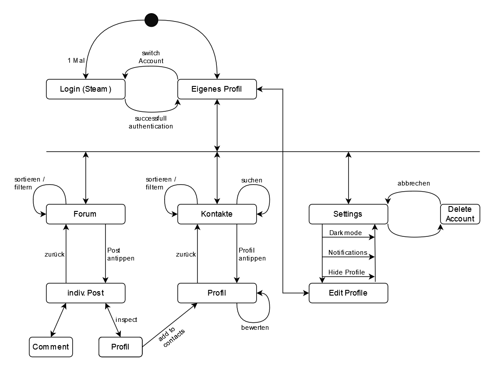
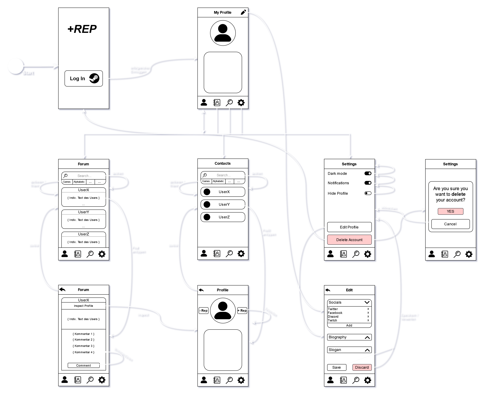

# 3. Meilenstein

### Navigationsübersicht

### Screendiagramm

### Papierprototyp
- **Beschreibung der Testfälle:**
    - 1. Mitspieler suchen. User soll sich ins Forum begeben und den Kontakt mit einer Person aufnehmen. 
    

    - 2. Mitspieler bewerten. User soll nach Kontaktaufnhame seinen Mitspieler bewerten. 
    

    - 3. Benachrichtigungen ausschalten. User soll in die Einstellungen und die Benachrichtigungen ausschalten . 
    

    - 4. Discord (Social-Link) verstecken. User soll in die Einstellungen und den Link zu seinem Discord-Profil verstecken . 
    

    - 5. Konto löschen. User soll in die Einstellungen und die Löschung seines Accounts beantragen. 
    

- **Feedback** 
- Bezieht sich auf Testfall 1.  

### Zusammenfassung
Die Testfälle haben gezeigt, dass die UI so wie wir sie geplant haben, größtenteils intuitiv benutzbar ist. 
Wir haben jedoch im 1. Testfall gemerkt, dass ein Button nicht als solcher zu erkennen war, und werden das in der Implementierung berücksichtigen. 

    

