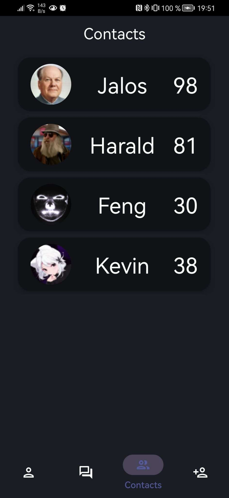
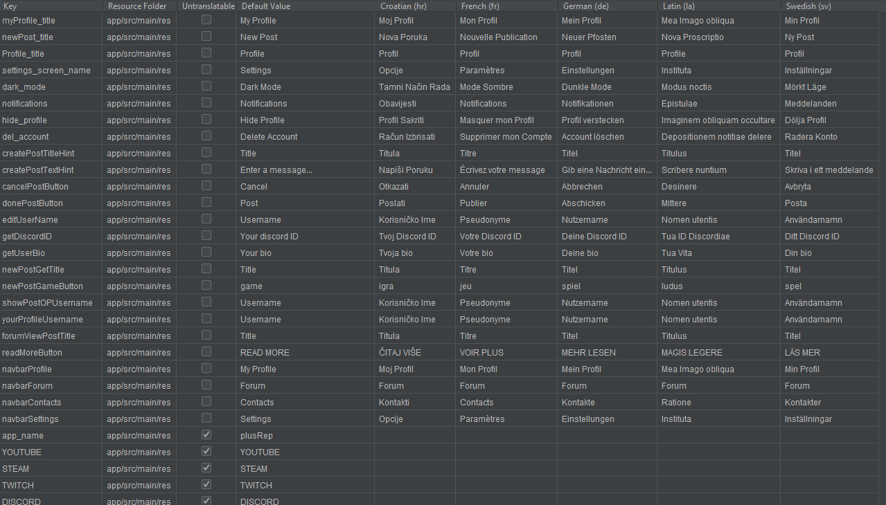
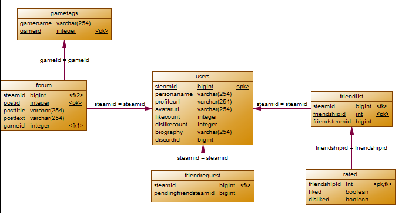

# 5. Meilenstein

Um unsere App zu testen, muss sie von der Beta Branch gepullt werden.

#### 1 - Login

Beim Start der App begrüßt uns ein simpler Screen mit einem schönen Logo und einem Login-Button um sich per [Steam](https://store.steampowered.com/?l=german) anzumelden. 

Es wird ein WebView mit der URL der SteamAPI erzeugt, um nach einem erfolgreichen Login mit [OpenID](https://de.wikipedia.org/wiki/OpenID), eine SteamID zu bekommen. 

Durch die SteamID können wir eine andere Schnittstelle von Steam ansprechen, wodurch wir die benötigten Daten (Username, Profil-URL ...) kriegen. 

Zuletzt wird dann das eigentliche Profil aufgerufen, dabei werden alle Steam bezogene Daten in die Datenbank eingetragen. 

 

#### 2 - My Profile
Freundlich springt uns ein Bild an, welches wir von Steam haben. Am Profilbild ist eine Anzeige, die den Score anhand von Likes und Dislikes ermittelt (dazu eine Anmerkung: siehe unten) 

Im dunklen Feld befindet sich unsere Biographie, diese können wir durch den Edit-Button (Stift) ändern, ebenfalls zu sehen sind die beiden Social-Media-Buttons welche beim anklicken einen Link zum jeweiligen Profil in die Zwischenablage speichern. 

Jedes Mal wenn man sich in unserer App anmeldet, werden die von der Steam API bezogenen Daten, mit dem aktuellen Daten in der DB verglichen. Bei bedarf werden diese dann aktualisiert und entsprechend angezeigt. 

Anmerkung: Für die Berechnung des Scores haben wir eine logarithmische Formel entworfen. Diese verhindert, dass User die wenige Bewertungen haben, einen höheren Score bekommen, als User die öfter bewertet wurden. 

**Tl;dr: [10 Likes : 1 Dislike] > [1 Like : 0 Dislike]**

 

#### 3 - Forum
Falls wir nun jetzt neue Bekanntschaften schließen möchten, können wir eine der gelisteten Beiträge öffnen und durchlesen. Bei enstprechendem interesse, kann man durch anklicken auf den angezeigten Benutzernamen, das Profil des anderen Users öffnen. 

Wenn wir für ein bestimmtes Spiel Beiträge suchen können wir diese über die Tags gefiltert anzeigen lassen.  
Falls kein Ansprechender Forumsbeitrag vorhanden ist können wir mit dem Stift-Button selbst einen Forumsbeitrag verfassen.    

 

#### 3 - Contacts
In der Kontaktliste werden alle befreundeten User in einer RecyclerView aufgelistet. 
Die Profilbilder, Benutzernamen und die Scores werden mit jedem Zugriff frisch von der Datenbank gezogen. 
Daraufklickend gelangen wir auf das jeweilige Profil. 

 

#### 4 - Fremdes Profil
Nun sehen wir ein schönes Benutzerprofil mit einem Profilbild, Benutzernamen und Score (ähnlich wie "My Profile"). Zusätzlich haben wir links und rechts vom Profilbild jeweils einen Button zum Liken oder Disliken. 

Durch das Drücken dieser wird automatisch der Score berechnet und in die Datenbank eingetragen. Da die Buttons beim inaktiven Zustand ausgegraut werden, ist es gut kenntlich, wie wir den User bewertet haben. 

Auf der linken Seite, unter dem Bild finden wir die Social-Media-Buttons, die uns die Links der entsprechenden Seiten geben. Rechts davon ist ein Knopf, womit wir dem User eine Freundschaftsanfrage senden können, bei Annahme wird er in der Kontaktliste eingefügt. Falls der User bereits ein Freund ist, ist an dieser Stelle ein Knopf welcher die Freundschaft beendet.  

 

#### 5 - Friend requests
Wir entschieden uns in der BottomNavigationBar den Settings-Screen, in die Gerät-Einstellungen auszulagern. Es ist uns nämlich im späteren Verlauf aufgefallen, dass man öfter auf den Freundschaftsanfragen-Screen gehen muss, um diese zu verwalten, als auf Einstellungen 

Die Funktion der Buttons auf den jeweiligen Anfragen haben wir durch die passende Auswahl von Farben und Symbolen, kenntlich gemacht. 

 

#### 6 - Sprachen!
Da nicht jeder Englisch kann, entschieden wir uns für alle Strings eine Übersetzung ins Deutsche, Französische, Lateinische, Kroatische & Schwedische anzubieten. Die jeweilige Sprache wird automatisch anhand der Smartphone-Einstellung für die App ausgewählt. 
 
**Disclaimer:** Sprachen können teilweise falsch oder in einem anderem Sinne übersetzt worden sein. Außerdem könnten übersetzungen unvollständing sein  

 

####  7 - Datenbankanbindung
Unsere App interargiert bei jedem Screenaufruf sowohl als auch beim Starten mit der Datenbank um die neusten Daten zu haben.  
Bei jeder Creaton / Bearbeitung oder beim Löschen wird immer die Datenbank geupdaten so das alle immer auf dem neusten Stand sein können.  
Als Datenbank haben wir uns für die AWS-Datenbank welche über den HDA-Login auf Rosettahub zugreifbar ist, entschieden.  
Ursprünglich hatten wir unsere Datenbank auf dem HDA eigenen Server. Da dieser aber zwischen dem 24.06 und 25.06 nicht mehr erreichbar war, waren wir leider dazu gezwungen auf eine kostenpflichtige Datenbank zu wechseln um die persistenz userer Daten zu gewähren.  

 
 
 

#### Beispiel Video
Im Folgenden sehen sie eine Beispielhafte Benutzung der App  

 

