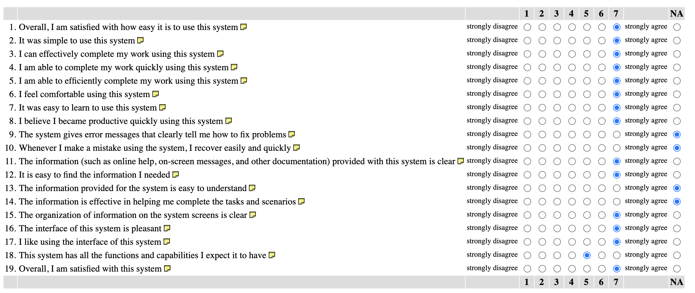

# 6. Meilenstein

#### 1 - Thinking Aloud

#### 2 - Usability Test

**[Protokoll](./m6/+REP_Protokoll.pdf)**

- **Login:**  
a. Effektivität: auf Anhieb erfolgreich  
b. Effizienz: aktiv bei 5 Touch Gesten und 1 Screen Wechsel  
c. Zufriedenheit: zufrieden  
d. Robustheit: Login wird neu angefordert beim Neustart aber nicht beim Beenden oder Pausieren. App lässt sich nicht drehen  

- **Profil bearbeiten:**  
a. Effektivität: auf Anhieb erfolgreich  
b. Effizienz: aktiv bei 5 Touch Gesten und 1 Screen Wechsel  
c. Zufriedenheit: zufrieden  
d. Robustheit: Daten beleiben nach dem Neustart. Beim Beenden ohne speichern werden die Daten verworfen. Beim Pausieren bleiben die Daten in den Feldern. App lässt sich nicht drehen  

- **Post für Spiel eigener Wahl erstellen:**  
a. Effektivität:   
b. Effizienz:   
c. Zufriedenheit:   
d. Robustheit:   

- **Nach einem Post für selbst ausgewähltes Spiel suchen:**  
a. Effektivität:   
b. Effizienz:   
c. Zufriedenheit:   
d. Robustheit:   

- **Freundschaftsanfrage verschicken:**  
a. Effektivität:   
b. Effizienz:   
c. Zufriedenheit:   
d. Robustheit:   

- **Steam Profil des neuen Freundes besuchen:**  
a. Effektivität:   
b. Effizienz:   
c. Zufriedenheit:   
d. Robustheit:   

- **Neuen Freund Bewerten:**  
a. Effektivität:   
b. Effizienz:   
c. Zufriedenheit:   
d. Robustheit:   

- **Freundschaftsanfrage akzeptieren:**  
a. Effektivität:   
b. Effizienz:   
c. Zufriedenheit:   
d. Robustheit:   

- **Freund entfernen:**  
a. Effektivität:   
b. Effizienz:   
c. Zufriedenheit:   
d. Robustheit:   

#### 3 - Interview

Beim Punkt 18 ist die Bewertung eine 5 weil:
- Es Fehlen die möglichkeiten einen Forum Post zu löschen und nach eigenen Beiträgen zu suchen

#### 4 - Design Review

1. Die **Schrift** ist gut lesbar
2. **Schrift** ist gut erkennbar und deren **Funktion** ist verständlich
3. **Farbgebung** ist auch schön (nicht auf jedem Gerät ist das dunkle passend)
4. Die **Größe** der **Bedienelemente** ist hervorragend
5. Die Navigationsbuttons sind sinnvoll **gruppiert**
6. Es gibt **Abstände**
7. Es **dreht** sich nicht, und das ist auch gut so

#### 5 - Verbesserungen

- Mehr Farbdifferenz zwischen dem Allgemeinen Hintergrund und dem Hintergrund der Beiträge
- Forumbeiträge löschbar / nach eigenen Beiträgen suchen können
- Datenbank speichert nicht ob schon geliked / disliked wurde wenn die Freundschaft beendet und wieder neu "begonnen" wird
- Startbildschirm nacharbeiten
- App-Icon hinzufügen
- Textfelder beim Profil bearbeiten und Post erstellen vergrößern, weil der Benutzer sonst den Eindruck bekommt nur einen kleinen Text verfassen zu können
- Textfelder sollte man lieber mit Labels versehen, statt nur hints bei einem leeren feld zu zeigen, um dem Benutzer besser zu zeigen wofür jedes Feld gedacht ist
- Ein anderes Icon für "Freundschaft Beenden" verwenden, um dem Benutzer die Funktion des Buttons besser zu vermitteln
